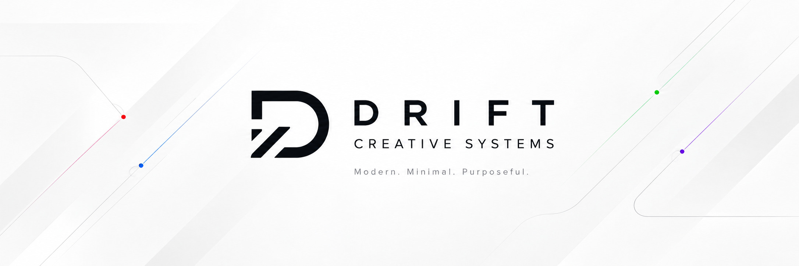

# Drift: Veneer

Free WordPress plugin by **Drift Creative Systems**. White labels wp-admin for clients: hides WordPress branding, adds a logo to the admin bar and login screen, sets the login colours and admin footer, and hides admin menus from everyone who isn't an agency user. Settings are under **Settings → Drift: Veneer**.

- WordPress.org slug: `drift-veneer` (submission pending)
- Licence: GPL-2.0-or-later
- Requires WordPress 6.0+, PHP 7.4+

The user-facing documentation is [readme.txt](readme.txt), which WordPress.org displays. This file is for developers.

## Structure

```
drift-veneer.php                              Bootstrap: duplicate-install guard, constants, requires, init on plugins_loaded
includes/
  class-drift-veneer-settings.php             drift_veneer_settings option: defaults() (filterable), saved(), get() (saved + defaults), save() (sanitising)
  class-drift-veneer-branding.php             Removes the admin bar WordPress menu, adds the admin bar logo, replaces the admin footer text and version
  class-drift-veneer-login.php                Login logo, background and colours via wp_add_inline_style( 'login' ); logo links to the site
  class-drift-veneer-access.php               "Agency user" profile checkbox, menu hiding, URL blocking, the Admin menus card
  class-drift-veneer-admin.php                Settings → Drift: Veneer screen, admin_post_drift_veneer_save handler, admin footer, Plugins-row link
assets/
  admin.js                                    jQuery: Media Library picker, colour pickers
  admin.css                                   Settings screen only
uninstall.php                                 Removes options on every site in a network, then the agency user meta
```

## Settings and defaults

Every field left blank falls back to `Drift_Veneer_Settings::defaults()`. Out of the box only **Hide WordPress branding** is on; logos, colours and footer text are all blank, so nothing else changes until someone configures it. The form shows the saved (raw) value with a "Blank uses the default: …" hint, so blank visibly means "default".

An agency can ship its own brand to every client site without touching the settings screen:

```php
add_filter( 'drift_veneer_defaults', function ( $defaults ) {
	$defaults['login_button_color'] = '#203364';
	$defaults['login_logo']         = get_stylesheet_directory_uri() . '/assets/images/login-logo.png';
	$defaults['footer_text']        = 'Website by Example Agency';
	$defaults['footer_url']         = 'https://example.com/';
	return $defaults;
} );
```

Only keys already in `defaults()` are accepted from the filter.

## Agency users and menu hiding

Clients are often Administrators, so role and capability checks can't tell agency staff and clients apart. Tying "full admin" to one user ID (as White Label CMS does) isn't safe across many sites either. Instead there's an **"Agency user" profile checkbox**.

- Agency users see everything. Everyone else, whatever their role, has the menus ticked on the settings screen removed (`admin_menu`, priority 9999).
- Hidden menus **and their submenu pages** are also blocked by URL on `current_screen` (403 via `wp_die()`), not just removed from the sidebar.
- **Lockout safety:**
  - Nothing is hidden until at least one agency user exists. Until then any administrator can tick the checkbox. Once one exists, only agency users can change it or see the settings screen (`can_manage()`).
  - If the last agency user unticks themselves, hiding switches off.
  - `index.php` (Dashboard) and `profile.php` are in `PROTECTED_SLUGS` and are never hidden or blocked.
- Default hidden menus: Appearance, Plugins, Users, Tools, Settings, ACF. Once the screen is saved, the saved list is used instead.

Any new "hide from clients" feature should use `Drift_Veneer_Access::is_restricted()` / `can_manage()`, not `current_user_can( 'manage_options' )`.

## Stored data

| Key | Where | What |
|---|---|---|
| `drift_veneer_settings` | option (not autoloaded) | Branding and login settings |
| `drift_veneer_hidden_menus` | option (not autoloaded) | Menu slugs hidden from non-agency users. Absent until the screen is saved |
| `drift_veneer_agency_user` | user meta | `1` for agency users |

All of it is removed in `uninstall.php`. Never rename these keys once released: sites have live data under them.

## Hooks

| Hook | Type | Purpose |
|---|---|---|
| `drift_veneer_defaults` | filter | Default settings, used for any blank field. Only existing keys are kept |
| `drift_veneer_default_hidden_menus` | filter | Menu slugs hidden from non-agency users before the screen is first saved |

```php
// Also hide Comments by default.
add_filter( 'drift_veneer_default_hidden_menus', function ( $menus ) {
	$menus[] = 'edit-comments.php';
	return $menus;
} );
```

## Known limits

- Only sidebar menus are hidden. The admin bar's own shortcuts (e.g. "New → User", "Customize") still show; the pages they open are blocked if their menu is hidden.
- URL blocking covers the menu page and its submenu pages. Other routes into the same feature (e.g. `post.php` for an ACF field group) aren't blocked; those normally need `manage_options` anyway.
- Running alongside White Label CMS will conflict. The settings screen warns while it's active.

## Development

- No build step. Edit `assets/*.js` / `*.css` directly.
- Coding standard: `phpcs.xml.dist` (WordPress, prefixes `drift_veneer` / `DRIFT_VENEER`).
- Run **Plugin Check** before every release. The PHPCS-based checks don't work in WordPress Playground (its filesystem can't `flock()`), so use a real install, e.g. WP-CLI with the SQLite drop-in:
  ```sh
  wp plugin install plugin-check --activate
  wp plugin check drift-veneer --include-low-severity-errors --include-low-severity-warnings \
    --require=./wp-content/plugins/plugin-check/cli.php
  ```
  Check a copy built from `.distignore`, not the repo, so dev files don't trip the `file_type` check.
- Menu hiding can lock people out of wp-admin. Test any change to `Drift_Veneer_Access` as an agency user, a non-agency administrator and an editor, and with no agency users at all.
- Directory guidelines review: the `wp-plugin-directory-guidelines` Claude Code skill.

## Releasing

1. Bump the version in **three** places: the `Version:` header, `DRIFT_VENEER_VERSION` and `Stable tag:` in `readme.txt`. Add a changelog entry to both `readme.txt` and `CHANGELOG.md`.
2. Merge `develop` → `main`, then publish a GitHub release tagged `vX.Y.Z`.
3. `.github/workflows/release.yml` checks the three versions match, builds `drift-veneer.zip` from `.distignore` and attaches it to the release.
4. Once approved on WordPress.org, set the repo variable `WPORG_DEPLOY=true` and the secrets `SVN_USERNAME` / `SVN_PASSWORD`. Releases then deploy to SVN automatically, and readme/asset changes on `main` sync on their own (`wporg-assets.yml`).

WordPress.org assets (icon, banners, screenshots) live in `.wordpress-org/`. Screenshots still need adding as `screenshot-1.png` (settings screen), `screenshot-2.png` (Admin menus card) and `screenshot-3.png` (login screen) to match `readme.txt`.

## Licence

GPL-2.0-or-later. See [LICENSE](LICENSE).

Copyright © 2026 Drift Creative Systems Ltd

Drift Creative Systems Ltd. Registered in England and Wales, company number 17548220. Registered office: 167-169 Great Portland Street, 5th Floor, London W1W 5PF
